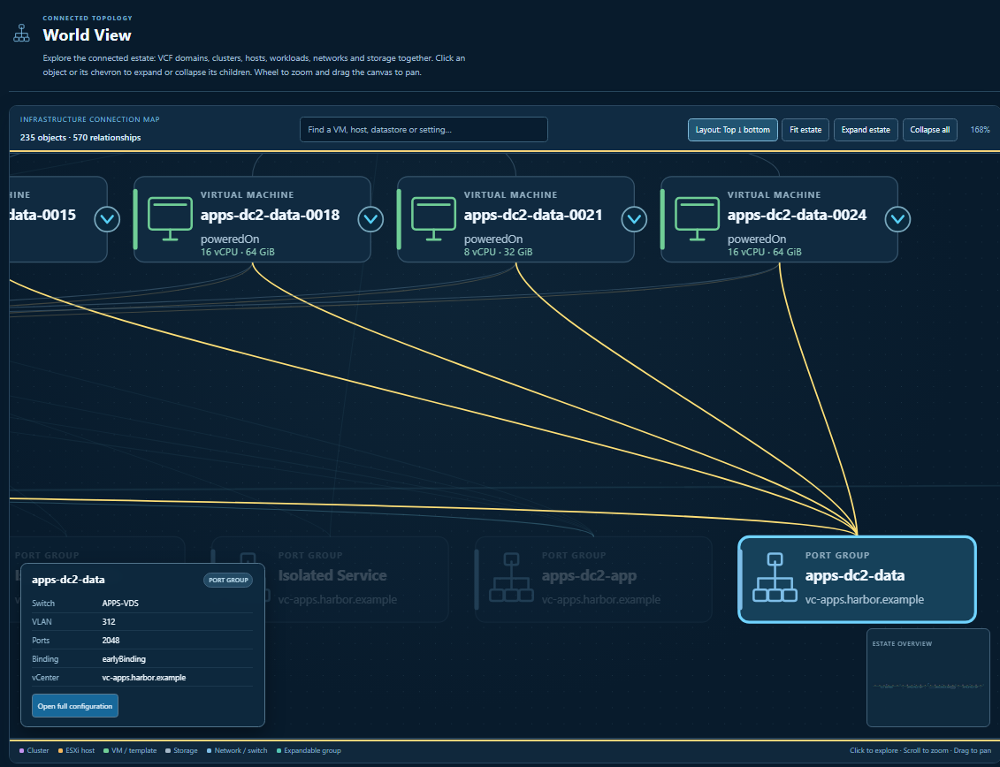
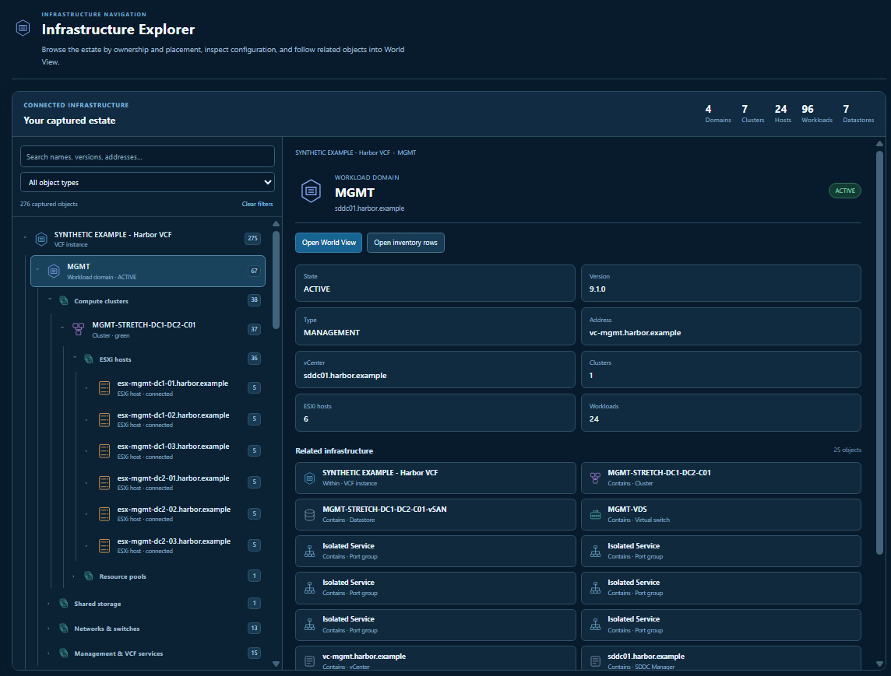
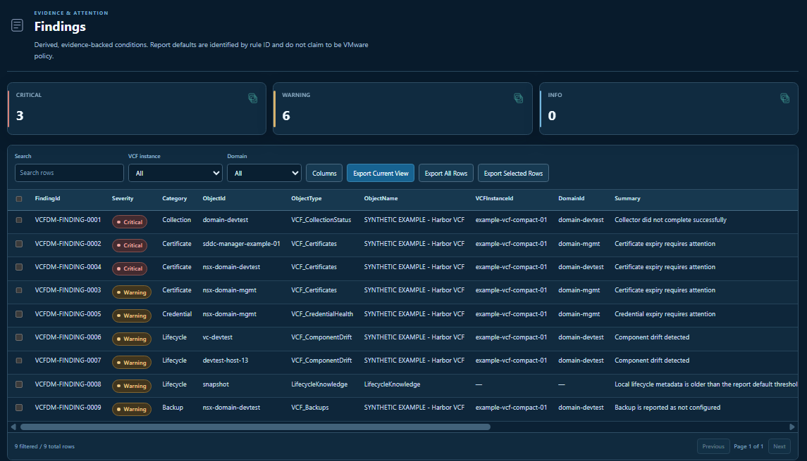

<p align="center">
  <picture>
    <source media="(prefers-color-scheme: dark)" srcset="src/Exporters/Assets/Branding/vcfexport-logo-dark.png">
    
  </picture>
</p>

<p align="center"><strong>Collect and audit your VCF fleet. One file.</strong></p>


# VCFexport

Collect VMware Cloud Foundation and vSphere inventory into portable HTML, JSON, Excel and CSV reports. Detailed inventory collection is integrated into VCFexport, covering 26 categories across VM configuration, hosts, clusters, storage, networking, licensing, health and orphan-file candidates.


Collector version: **0.1.0**. Snapshot schema: **1.1**. Each live run starts from one SDDC Manager and collects its discovered or explicitly selected vCenters.

## Report previews

These screenshots use synthetic inventory from the two-datacenter example report.

### World View

Explore connected objects, click to reveal child objects, and inspect relationships between workloads, networks and storage.



### Infrastructure Explorer

Browse domains, clusters and hosts in the infrastructure tree, inspect configuration, and follow related objects into World View.



### Findings

Review findings by severity, filter the captured evidence, and export results covering certificate expiry, version drift and backup configuration.



## Requirements

- PowerShell 7.4 or later.
- `VCF.PowerCLI` for live collection.
- `ImportExcel` 7.8.0 or later for command-line Excel export, which is enabled by default.
- A modern browser to view the HTML report.

External PowerShell modules are installed separately and are not bundled in this package.

## Setup and collection

Extract the complete release folder. Keep `VCFExport.ps1` and `src/` together with their folder structure intact. Open PowerShell 7 in that folder and install the modules once:

```powershell
Install-Module VCF.PowerCLI -Scope CurrentUser
Install-Module ImportExcel -MinimumVersion 7.8.0 -Scope CurrentUser
```

For an isolated workstation, stage these modules and their dependencies through your normal offline software-transfer process.

Use an account with inventory and metadata access to SDDC Manager and the target vCenters. Replace the example hostname with your SDDC Manager:

```powershell
$credential = Get-Credential
.\VCFExport.ps1 -SddcManager sddc01.example.local -Credential $credential -OutputPath C:\Reports\VCF -SkipDatastoreFileScan
```

This creates HTML, JSON and Excel outputs. Open the returned `HtmlPath` in a browser and review **Collection Status** before interpreting missing data. The generated HTML is self-contained and can be shared and viewed offline.

- Add `-OutputFormat Json,Html` to omit command-line Excel export; ImportExcel is then unnecessary.
- Add `-OutputFormat Json,Html,Excel,Csv` to create all four output formats.
- Add `-VCenterCredential (Get-Credential)` if vCenter needs different credentials.
- Add `-VCenterFqdn vc01.example.local,vc02.example.local` to select vCenters explicitly; otherwise they are discovered through SDDC Manager.
- Remove `-SkipDatastoreFileScan` to include the datastore orphan-candidate scan, which can be expensive on large datastores. It reports candidates for review and never deletes files.
- Add `-LifecycleMetadataPath D:\Transfer\vcf-offline-depot-metadata.zip` to supply an offline lifecycle reference.

## Detailed inventory and exports

World View fills the available window height, supports left-to-right and top-to-bottom layouts, and lets you click objects or their chevrons to reveal child objects.

The HTML report's **Detailed Inventory** view contains all 26 categories, with search, column selection, row details and Excel downloads. Workbook generation in the browser works offline and does not require ImportExcel.

Command-line Excel output includes `INV_<category>` worksheets. CSV export creates `Inventory-<category>.csv` files for populated categories and a manifest covering empty categories. JSON stores these records in the `Inventory` container. Virtual Configuration and World View also use the detailed records.

## Regenerate reports from a saved snapshot

```powershell
.\VCFExport.ps1 -SnapshotPath C:\Reports\VCF\existing-snapshot.json -OutputFormat Html -OutputPath C:\Reports\Regenerated
```

Replace the example path with your saved JSON snapshot. HTML-only regeneration does not connect to the environment and does not require VCF.PowerCLI or ImportExcel. Select `Html,Excel,Csv` to generate the other reports as well; Excel requires ImportExcel.

Existing schema 1.0 snapshots remain supported. Their detailed inventory and collection-status names are upgraded in memory to schema 1.1 without changing the original JSON file. Records that were not captured remain absent.

## Licence

VCFexport is distributed under the included [MIT licence](LICENSE). The integrated inventory functions retain their MIT copyright and permission notice in `src/Collectors/VcfDm.Inventory.Functions.ps1`. Preserve the licence and included notices when redistributing this package.
